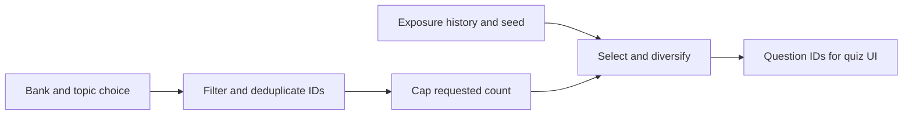

# Databricks Associate Study App

Interactive Databricks Data Engineer Associate study app with a weekly plan, focused and mixed quizzes, and weak-topic recommendations.

## What it does

- Tracks Day 0–Day 7 weekly study completion with local persistence.
- Runs focused-topic and mixed/exam-style quiz sessions.
- Shows weak-topic recommendations from quiz performance.
- Lets users resume active quizzes and reset all local study state.

## Stack

- React 19, Vite, TypeScript
- Vitest + Testing Library
- Playwright (E2E)
- ESLint + Prettier

## Quick start

```bash
nvm use
npm install
npm run dev
```

## Quality checks

```bash
npm run typecheck
npm run lint
npm run test
npm run test:e2e
npm run ci
```

> Note: `npm run test:e2e` skips locally when Playwright browser binaries are unavailable; CI still enforces full E2E execution.

## Scope notes

- Local-only storage (no backend/auth in v1).
- Weekly checklist and Quiz are the two core app experiences.

## Architecture: one state owner, explicit browser I/O

`App` owns the study journey and delegates persistence to a small storage adapter. That keeps practice account-free, but storage access failures have no recovery UI and clearing browser storage loses progress.

[](docs/architecture/README.md)

[Trace the source, decisions and failure boundaries](docs/architecture/README.md), or [download the standalone interactive diagram](https://raw.githubusercontent.com/wolffrichardj/databricks-associate-study-guide/main/docs/architecture/study-app.html) and open the saved HTML locally. GitHub does not run this HTML as a hosted app.

## Build notes and lessons learned

To see the lessons we learned and how we built and managed this codebase, go here: [LESSONS_LEARNED.md](./LESSONS_LEARNED.md).

## Engineering proof: duplicate-question selection

This independent React and TypeScript study project uses an agent-assisted workflow. The [build notes](./LESSONS_LEARNED.md) record phone-led objective setting, asynchronous work through Codex, Jules and GitHub, and tests/screenshots as review evidence. Commit identity does not establish who wrote each line.

### A bounded failure/fix

Selecting array entries is not enough to ensure unique question IDs when the input contains duplicates. The March 7, 2026 [deduplication and no-replacement fix](https://github.com/wolffrichardj/databricks-associate-study-guide/commit/29209a18987d6e6b933c57ce73b2aa6e868c9414) added deduplicated availability and duplicate-ID regression coverage. Requested session size is capped to the available unique pool. This describes source/history, not an observed learner incident.



Inspect the [selection implementation](https://github.com/wolffrichardj/databricks-associate-study-guide/blob/53a35a9d89da5755d94d1d2880f6023c4d6f90b0/src/lib/quiz.ts) and [test source](https://github.com/wolffrichardj/databricks-associate-study-guide/blob/53a35a9d89da5755d94d1d2880f6023c4d6f90b0/src/test/quiz.test.ts). The duplicate-bank fixture asserts unique output IDs; separate cases check focused-topic membership, requested size with sufficient supply and an oversized request. These are bounded examples, not an exhaustive correctness proof.

A [follow-up](https://github.com/wolffrichardj/databricks-associate-study-guide/commit/9f187129934cb6aff7500ec6ce681f0ecb415e04) added template diversification. Recent-exposure preference and template variety are heuristics, not guarantees of zero repeats or optimal coverage.

### Repeatability and validation

Selected question IDs are repeatable for the same ordered bank, configuration, exposure history and explicit seed. The complete session also contains a clock-derived timestamp, and the normal UI uses a clock-derived seed.

Source/test inspection baseline: `53a35a9d89da5755d94d1d2880f6023c4d6f90b0`. See the [November 10, 2026 publication validation record](https://github.com/wolffrichardj/databricks-associate-study-guide/pull/25) for the actual tested revision, commands, results, known limits and Playwright screenshots of Weekly Plan, quiz setup and a quiz in progress. That dated record is distinct from current CI status.

Local `test:e2e` can exit successfully after skipping unavailable browser binaries. Use `CI=true npm run test:e2e` and inspect the executed desktop/mobile cases when recording a browser pass. The suite starts Vite's development server; a build or browser pass does not establish production-host behavior or real-device acceptance.

### Scope

Browser-local progress keeps the app account-free; it does not provide cloud sync, and clearing browser storage can lose progress. This is an independent personal study project. Current exam alignment, question provenance and reuse licensing have not been reviewed for this engineering summary; no root license file is present at the source revision above. No official endorsement, certification success, learner count, enterprise adoption or measured AI productivity gain is claimed. A hosted app demo has not been verified.
